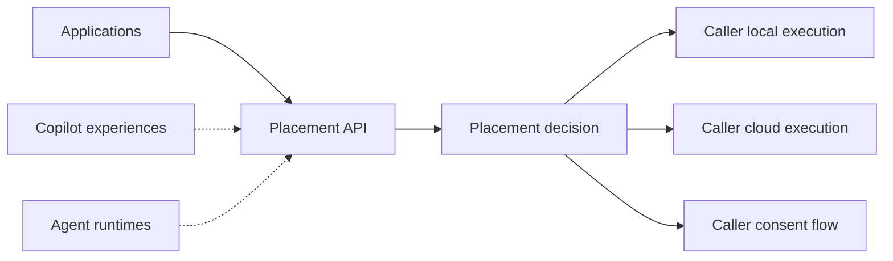
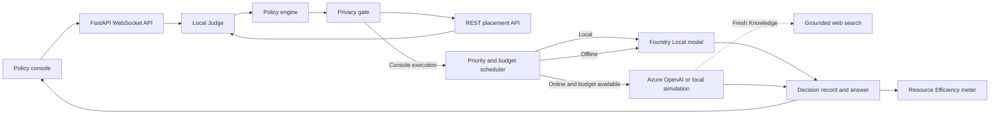
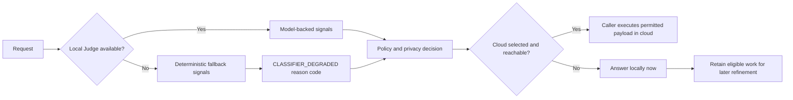

## Use AI in the Right Place

**Keep work local by default and use cloud intelligence when policy and user
needs justify it.**

Every AI request has a best place to run. Most applications do not decide; they
default to cloud. Use AI in the Right Place makes that decision explicit before
execution.

**Intelligence is becoming abundant. Energy and connectivity are not.
AI should optimize for the scarce resource, not only the smartest model.**

Use AI in the Right Place is a policy-driven request-placement layer that
applications, copilots, and agents can call before executing AI work. It
evaluates urgency, reasoning depth, freshness, privacy, connectivity, and
budget, then returns an inspectable local, cloud, or consent-required decision.
The caller remains in control of execution.

> **Use AI in the right place, under explicit policy.**

The differentiator is not another model router. The service combines request
intent with privacy, connectivity, consent, and resource constraints, returns
the payload that is permitted to leave the device, and lets the caller retain
control of execution.


## Policy console

Follow the [two-minute executive demo](docs/DEMO.md) for exact prompts,
narration, recording shots, and recovery steps.

## Two-minute demo path

| Time | Show | Prove |
|---|---|---|
| 0:00-0:15 | Positioning and high-level architecture | Placement is a reusable layer before execution |
| 0:15-0:30 | Detailed Foundry architecture | Judge, policy, privacy, scheduling, local, and cloud are implemented |
| 0:30-0:45 | Algarve prompt | Stable work stays local |
| 0:45-1:00 | FIFA prompt | Fresh knowledge receives cloud capability |
| 1:00-1:12 | FIFA while disconnected | Local fallback responds now and retains cloud refinement |
| 1:12-1:30 | Full scenario | Priority, consent, local work, and cloud work coexist |
| 1:30-1:42 | Savings panel | Placement produces measured operational outcomes |
| 1:42-1:49 | Placement API | Applications and agents can request a decision without model execution |
| 1:49-2:00 | Performance scorecard | Quality, critical recall, placement overhead, and scope are visible |

## Performance at a glance


These figures measure deterministic placement behavior and integration
overhead, not model inference or answer latency. See [Evaluation](#evaluation)
for benchmark scope, route-quality limitations, and reproduction commands.

## Request-placement API

`POST /v1/placement/decide` returns a decision without invoking an answer
model. Existing applications can use the endpoint before their own local or
cloud execution path.

```powershell
$body = @{
  input = "Compare two architecture options for this service."
  context = @{
    connectivity = $true
    cloud_budget_kb = 20
    required_capabilities = @("extended_reasoning")
    available_local = @("phi-4-mini")
    available_cloud = @("gpt-5")
  }
} | ConvertTo-Json

Invoke-RestMethod `
  -Method Post `
  -Uri http://127.0.0.1:8000/v1/placement/decide `
  -ContentType "application/json" `
  -Body $body
```

The response includes a correlation ID, placement, policy, permitted payload,
consent requirement, local fallback, suggested models, stable reason codes, and
an explanation. OpenAPI details are available at
<http://127.0.0.1:8000/docs> while the service is running.

```json
{
  "decision_id": "4e899b33-13bb-4b77-9e41-54738be58458",
  "placement": "cloud",
  "policy": "Deep Reasoning v1",
  "permitted_payload": "Compare two architecture options for this service.",
  "requires_consent": false,
  "fallback": "local",
  "suggested_models": ["gpt-5"],
  "reason_codes": ["CLOUD_CAPABILITY_REQUIRED"],
  "explanation": "Cloud capability is required and currently available."
}
```

The caller handles the result:

* `local`: Execute with the caller's local model
* `cloud`: Send only `permitted_payload` to the caller's cloud model
* `cloud_with_consent`: Show `permitted_payload` and wait for user approval
* `deferred`: Keep the request pending because the remaining budget is too low

### Bounded v2 POC

The Draft 4 POC is exposed from the standalone `app.api:app` entry point
and does not start the demo scheduler:

```powershell
$env:RELAYIQ_POLICY_CONFIG = (Resolve-Path .\config\relayiq-policy.json)
python -m uvicorn app.api:app --host 127.0.0.1 --port 8891
```

It serves `POST /v2/placement/decide` while the existing `app.main:app` keeps
the v1 API and policy console unchanged. See
[the bounded v2 POC guide](docs/relayiq-v2-poc.md) for its strict request
shape, trusted configuration, Judge sensitivity scope, and focused checks.
For copy-paste PowerShell scenarios and expected responses across the major
contract branches, use the [contract validation guide](docs/placement-v2-validation.md).

The bundled policy revision is `relayiq-judge-v1`. The v2 Judge uses the LLM
to detect email addresses only for `classification.sensitive_data` and
`SENSITIVE_DATA_DETECTED`, returning `sensitive_data_types: ["email_address"]`
on a positive finding. Employee IDs, social security numbers, and other
non-email information alone do not trigger that finding. Consent remains an
independent assessment and may still be required for other confidential data;
callers must retain their broader redaction and disclosure safeguards.
Out-of-scope or invalid model assessments degrade rather than publishing
unsupported findings. Restart the v2 service to load policy or Judge changes.

V2 model requests have a configurable inference inactivity timeout
(`JUDGE_TIMEOUT_SECONDS`, default 30 seconds) and no automatic SDK retries.
Timeouts return degraded classification, not a negative email finding. This
does not cap model download/loading time or make a slow model faster; preload
an appropriate model variant for the machine before testing.

The v2 prompt requests six strict booleans, including the unambiguous internal
`email_detected` signal. The adapter maps that signal to the existing public
`classification.sensitive_data` and `["email_address"]` category, without
fabricating missing flags; consent remains independent. Redundant internal
routing fields are derived from the model's signals. This reduces the v2 output
budget to 160 tokens without changing the API or legacy v1 Judge interface.

**Judge model selection:** Set `JUDGE_MODEL` in the process environment or the
repository's `.env` file; the environment wins, and the default is `phi-4-mini`.
RelayIQ uses the first loaded Foundry model whose ID starts with that value
(case-insensitive), or tries to load it if none matches. Use an explicit ID such
as `Phi-4-mini-instruct-generic-cpu` when multiple variants are loaded, and
restart the API after changing the setting. Request `model_mapping` lists
candidate answer models; it does not select the Judge.

`CLASSIFIER_DEGRADED`, `CONNECTIVITY_UNAVAILABLE`, and
`CLOUD_BUDGET_EXCEEDED` reason codes identify fallback classification, offline
local placement, and budget deferral. The API makes no answer-model call. The
policy console is the reference caller that executes the returned decision.

### Pi coding-agent integration

`integrations/pi/` is a distributable Pi extension package. It keeps Pi's
persistent session and tools on an explicitly configured local model, calls this
placement endpoint for each idle text prompt, and runs cloud decisions as
isolated, history-free Cloud Advisor completions. Consent-gated work displays
the exact `permitted_payload` before any cloud call.

See [integrations/pi/README.md](integrations/pi/README.md) for installation,
model-lane configuration, commands, and security boundaries.

## Demo cases

### Stable knowledge stays local

```text
What's the average sea temperature in Algarve, Portugal in August?
```

This asks for a typical seasonal average, not a live measurement. The local
Judge marks it as low reasoning with no fresh-knowledge requirement, so
`phi-4-mini` answers entirely on device and avoids a cloud call.


### Current knowledge requires web-grounded cloud capability

```text
What country won FIFA 2026 in July?
```

The answer depends on an event after the local model's training cutoff. Fresh
Knowledge v1 sends the request to the configured cloud deployment and requires
grounded web search. Use AI in the Right Place provides the current answer with an
authoritative FIFA source.

### The same request adapts during an outage

With connectivity disabled, Use AI in the Right Place cannot reach the cloud or
web search. Resilient Fallback v1 returns a best-effort local answer immediately
and retains the request for refinement after reconnection. The answer is visibly
limited by the local model's training cutoff, which is the expected offline
tradeoff.


## Mixed workload under scarce resources

Select **Run scenario** to submit seven different requests at once. Every
request passes through the on-device `phi-4-mini` Judge, which classifies
urgency, reasoning depth, and freshness. The policy engine then combines those
signals with connectivity and budget. A deterministic local privacy gate scans
for sensitive markers before any cloud egress.

### Critical work receives priority

The urgent medical request is classified as critical and cloud eligible. When
connectivity and budget are available, the scheduler ranks it above the general
health request and uses the configured cloud deployment with web grounding.

The medication question also needs extended reasoning, but its general urgency
places it behind critical work when both are waiting in the cloud queue.

### Privacy remains local until approval

For a cloud-bound emergency containing an employee ID and phone number, Privacy
Guard v2 redacts both values locally and pauses cloud egress. The user can
approve only the sanitized payload or keep the request on device. Immediate
local guidance remains available while consent waits.

Sensitive local-only requests do not require approval because no data leaves
the device.

### Routine work uses sufficient local capability

Educational, agricultural, and casual requests stay on device because the local
model is sufficient. Each avoided cloud call contributes to the measured
Resource Efficiency Score.


## Why it is different

Model selection is an outcome, not the product. Policies determine intelligence
placement and produce a human-readable decision record for every request.

```text
Decision: Pending approval
Policy: Privacy Guard v2
Reason: Sensitive data detected; extended reasoning requested
Action: Sanitize locally, show the payload, wait for human consent
Estimated cloud cost: $0.0031
```

The current policy catalog includes:

* Local First v1 for stable, low-reasoning work
* Fresh Knowledge v1 for time-sensitive information
* Deep Reasoning v1 for extended analysis
* Privacy Guard v2 for local sanitization and human approval
* Resilient Fallback v1 for immediate local help during outages

See [docs/policies.md](docs/policies.md) for precedence and behavior.

## Architecture

At the ecosystem level, the service is an isolated decision boundary:



Solid lines show the implemented application and API path. Dashed lines show
potential integration surfaces, not shipped Microsoft 365 Copilot or agent
integrations.

Inside the working Foundry proof, the same decision drives execution:



The REST API stops after the privacy-aware decision. The included console
continues through scheduling and Foundry execution to prove the policy path end
to end. See [docs/architecture.md](docs/architecture.md) for boundaries and the
complete artifact map.

## Try the adaptive demo

1. Submit a stable educational prompt and inspect the Local First decision.
2. Submit a sensitive analysis request and inspect the sanitized payload.
3. Disable connectivity and submit a deep request to trigger Resilient Fallback.
4. Restore connectivity and watch priority scheduling resume.
5. Reduce the cloud budget and observe requests move to deferred state.

The console explains the selected model, policy, reason, action, constraints,
and estimated cloud cost for every classified request.

## Quick start

### Prerequisites

* Windows 11
* Python 3.11 or later
* Git

### 1. Install Foundry Local

Open PowerShell and install Foundry Local:

```powershell
winget install Microsoft.FoundryLocal
```

Close and reopen PowerShell, then verify the installation:

```powershell
foundry --version
```

### 2. Download the repository

```powershell
Set-Location $HOME\Documents
git clone https://github.com/mmorozova_microsoft/RelayIQ.git
Set-Location RelayIQ
```

If the repository is private, GitHub will ask you to authenticate.

### 3. Create the Python environment

```powershell
python -m venv .venv
Set-ExecutionPolicy -Scope Process -ExecutionPolicy Bypass
.\.venv\Scripts\Activate.ps1
python -m pip install --upgrade pip
pip install -r requirements.txt
```

### 4. Create the configuration

```powershell
Copy-Item .env.example .env
```

### 5. Download the local model

```powershell
foundry server start
foundry model load phi-4-mini
```

The first model download can take several minutes. RelayIQ auto-discovers the
running Foundry Local endpoint. If discovery is unavailable, set
`FOUNDRY_ENDPOINT` in `.env` to the Foundry Local loopback endpoint.

### 6. Start the service

```powershell
python -m uvicorn app.main:app --host 127.0.0.1 --port 8000
```

Keep this PowerShell window open while using the service. Wait until it displays:

```text
Uvicorn running on http://127.0.0.1:8000
```

### 7. Open the policy console

Open <http://127.0.0.1:8000> in a browser, or run this command in another
PowerShell window:

```powershell
Start-Process "http://127.0.0.1:8000"
```

### Run the service later

After the first-time installation, use:

```powershell
Set-Location $HOME\Documents\RelayIQ
Set-ExecutionPolicy -Scope Process -ExecutionPolicy Bypass
.\.venv\Scripts\Activate.ps1
python -m uvicorn app.main:app --host 127.0.0.1 --port 8000
```

Press `Ctrl+C` in the server window to stop the service.

Azure configuration is optional. Without an available cloud deployment, Use AI
in the Right Place uses a local model to simulate the cloud lane while
preserving queue and byte accounting behavior. Never commit `.env` or
credentials.

The default local model is `phi-4-mini` for the Judge and local answers. Cloud
work uses the deployment named by `AZURE_OPENAI_DEPLOYMENT` through the
Microsoft Foundry Responses API. The console header displays both active model
names and identifies local cloud simulation when Azure authentication is
unavailable.

## Standalone v2 placement API

See the [v2 API guide](docs/relayiq-v2-poc.md) for Foundry Local startup,
standalone server commands, and sample local, cloud, fallback, and blocked
requests with expected responses. The guide also shows how an
operator-controlled policy can permit a cloud recommendation without requiring
consent.

## Resource Efficiency Score

Use AI in the Right Place reports an intentionally transparent composite:

$$
KES = \frac{B + C + P}{3}
$$

Where $B$ is bandwidth saved, $C$ is cloud calls avoided, and $P$ is detected
private-marker retention. $P$ participates only after a private marker is found.

Payload bytes are measured. USD, EUR, and CO2 values are modeled estimates from
the configurable coefficients in `.env.example`; they are not measured billing
or emissions data.

## Evaluation

Regenerate the datasets and run the 200-case mixed challenge benchmark:

```powershell
python eval/generate_synthetic_dataset.py
python eval/evaluate_judge.py --force-fallback
```

Run deterministic matrix conformance and all regressions:

```powershell
python eval/evaluate_judge.py --suite synthetic --force-fallback
python -m unittest discover -s tests -v
```

The challenge benchmark contains 36 hand-authored adversarial seeds and 164
seeded matrix cases. The reproducible fallback-policy baseline reports 96.50%
urgency accuracy, 96.48% macro urgency F1, zero critical misses across 66
critical cases, 74.00% route accuracy, 50.37% macro route F1, under 0.3 ms p95
placement latency in the recorded run, and 100% decision success across all 200
cases.

| Quality evidence | Result | Meaning |
|---|---:|---|
| Urgency accuracy | 96.50% | Correct urgency label across the mixed benchmark |
| Critical recall | 100% (66/66) | No critical candidate label was missed in this run |
| Route accuracy | 74.00% | Placement quality still needs improvement |
| Decision success | 100% (200/200) | Every in-process benchmark call returned a decision |

## Placement-layer overhead

The deterministic classification, policy, and privacy path measured under
`0.3 ms` p95 across 200 cases in repeated recorded runs. In a separate
five-request warmed loopback check, the REST boundary added approximately
`3.2 ms` mean overhead for HTTP transport, validation, the worker hop, and
serialization.

These figures describe placement integration overhead, not total decision or
answer latency. Judge model inference, hardware acceleration, scheduling,
network latency, and downstream execution depend on the caller's selected
models and deployment environment and are excluded from this claim.

## Fallback behavior



The expanded quality result shows that urgency improved while route quality
remains the next priority, especially unnecessary cloud placement. The
generated cases use candidate labels and repeated templates. They broaden
regression coverage but do not equal 200 independently reviewed prompts or
establish production quality, safety, or service-level availability. Decision
success is benchmark completion, not production uptime.

## Repository map

| Path | Responsibility |
|---|---|
| `static/index.html` | Responsive policy console and live WebSocket rendering |
| `app/main.py` | FastAPI entry point, commands, and demo scenario |
| `app/placement.py` | Side-effect-free placement contract and decision engine |
| `app/judge.py` | Local urgency, reasoning, and freshness classification |
| `app/policy.py` | Placement policies and human-readable decision records |
| `app/privacy.py` | Sensitive-data detection and local sanitization |
| `app/scheduler.py` | Priority queue, network adaptation, budget, and metrics |
| `app/foundry.py` | Foundry Local and Azure OpenAI adapters |
| `eval/` | Mixed challenge and synthetic evaluation workflows |
| `tests/` | API, placement, Judge, privacy, policy, scheduler, and metric regressions |
| `docs/` | Architecture, policies, pitch, and demo playbook |

## Contributing and security

See [CONTRIBUTING.md](CONTRIBUTING.md) for local checks and
[SECURITY.md](SECURITY.md) for responsible vulnerability reporting. This is a
prototype and must not replace emergency services, medical professionals, or
production data-loss-prevention controls.