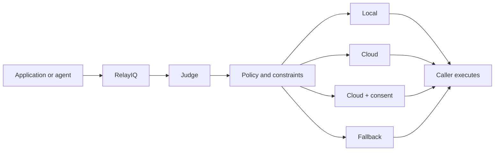

# RelayIQ

**Local when it is enough. Cloud when it is worth it. Policy-controlled
throughout.**

Imagine asking AI to rewrite one sentence and sending it across the internet to
a large cloud model every time. Powerful? Yes. Necessary? Often, no.

RelayIQ is a policy-backed placement API. Before an application or agent calls
an AI model, RelayIQ recommends **where the work should happen**.

| Placement | When it is used |
|---|---|
| **Local** | Local capability is sufficient |
| **Cloud** | Fresh knowledge, deeper reasoning, or another capability justifies it |
| **Cloud + consent** | Cloud is appropriate, but user approval is required first |
| **Fallback** | Policy, connectivity, or budget requires local execution or a stop |

RelayIQ does not answer the prompt. The caller remains responsible for model
execution, user approval, and redaction.

## How it works



1. The caller sends the prompt, model inventory, and runtime constraints.
2. A small local Judge classifies the request as routine, fresh, reasoning-heavy,
   critical, or sensitive.
3. Policy evaluates connectivity, cloud data budget, consent, and privacy.
4. RelayIQ returns a placement decision with reason codes.
5. The caller executes the recommendation.

## Demo with Agent 007

Agent 007 demonstrates RelayIQ as a pluggable decision layer in front of an
agent:

- Routine work stays local.
- Fresh knowledge or deeper reasoning can use cloud capability.
- Sensitive cloud work pauses for approval.
- The approval card shows only RelayIQ's recommendation and **Stop**,
  **Use local**, and **Use cloud** actions. Full system prompts and conversation
  history remain hidden.
- Fresh or critical work that requires unavailable cloud capability stops
  instead of silently returning a stale or insufficient local answer.


The local demo lane uses Phi-4-mini. Model and provider bindings for the cloud
lane are caller configuration and are not part of RelayIQ's API contract.

## Placement API

The standalone API exposes `POST /v2/placement/decide`. It returns a decision
without invoking an answer model.


Example outcomes:

| Request | Conditions | Decision |
|---|---|---|
| Summarize meeting notes | Local model available | `local` |
| Check the latest external policy | Cloud available | `cloud` |
| Check the latest HR policy for `e-104@example.com` | Cloud available | `cloud_with_consent` |
| Critical request requiring cloud | No connectivity or cloud budget | `fallback` + `stop` |

## Judge quality

The latest evaluation uses
[`RelayIQ_Email_Placement_v2_Evaluation_100`](eval/data/RelayIQ_Email_Placement_v2_Evaluation_100.xlsx),
a synthetic set of 100 labeled requests across routine, fresh-knowledge,
offline, budget-constrained, critical, and sensitive scenarios.

| Evaluation result | Score |
|---|---:|
| Target alignment | **97%** |
| Exact placement, including consent | **88%** |
| Expected decisions | **55 local / 25 cloud / 20 consent** |

The set contains 20 synthetic email-positive requests: 15 dedicated sensitive
cloud cases and five email-positive critical cases. Those five cross-scenario
cases revealed one shared gap: email detection did not always force consent.

The Judge now explicitly enforces **email detected -> consent required**. It
also recognizes changing information such as weather, news, prices, schedules,
and current external policies as fresh knowledge, and reports critical urgency
with a dedicated reason code.

The percentages are candidate-policy evaluation results, not a production SLA
or a measure of answer quality. A separate deterministic fallback benchmark is
available in [the evaluation report](eval/reports/judge_eval_latest.md).

## Modeled cost impact

For the same 100-request workload:

| Scenario | Modeled cost |
|---|---:|
| Cloud-only baseline | **$1.01** |
| RelayIQ-routed | **$0.45** |
| Cloud spend avoided | **$0.56** |

The model keeps 55 requests local and avoids 55 cloud calls. It assumes 500
output tokens per cloud request, 100% consent grant, and GPT-5.6 pricing of
`$4 / 1M` input tokens and `$20 / 1M` output tokens. Judge cost is included.
These are modeled values, not measured billing or emissions.

## Privacy boundary

- RelayIQ recommends placement; it does not redact the payload.
- The caller must obtain approval and sanitize data before cloud transfer.
- Its current sensitivity scope is email addresses. A negative email finding is
  not a general declaration that a payload is safe.

## Why it matters

Traditional model routers choose **which model** to use. RelayIQ first asks
**where the work should happen at all**.

Keeping suitable work local can reduce cloud compute, network transfer, and LLM
cost. It also supports field workers, remote communities, humanitarian
organizations, and regulated environments where connectivity or cloud
disclosure is limited.

## Run the v2 demo

### Prerequisites

- Windows 11
- Python 3.11 or later
- [Foundry Local](https://learn.microsoft.com/azure/foundry-local/get-started)

```powershell
git clone https://github.com/mmorozova_microsoft/RelayIQ.git
Set-Location RelayIQ

python -m venv .venv
.\.venv\Scripts\Activate.ps1
pip install -r requirements.txt

foundry server start
foundry model load phi-4-mini

$env:RELAYIQ_POLICY_CONFIG = (Resolve-Path .\config\relayiq-policy.json)
python -m uvicorn app.api:app --host 127.0.0.1 --port 8891
```

Open <http://127.0.0.1:8891/docs>.

## Learn more

- [v2 placement API guide](docs/relayiq-v2-poc.md)
- [v2 contract validation scenarios](docs/placement-v2-validation.md)
- [Architecture and trust boundaries](docs/architecture.md)
- [Legacy policy-console demo](docs/DEMO.md)
- [Policies](docs/policies.md)
- [Pi integration](integrations/pi/README.md)
- [Contributing](CONTRIBUTING.md)
- [Security](SECURITY.md)

RelayIQ is a prototype. It must not replace emergency services, medical
professionals, or production data-loss-prevention controls.
