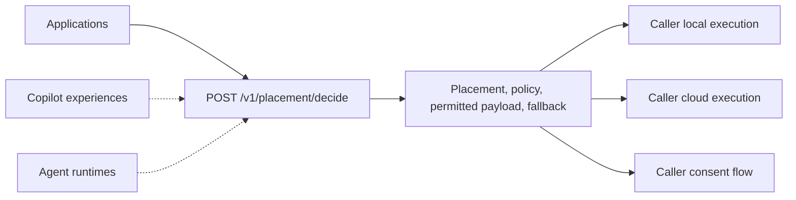
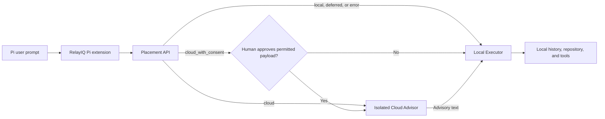
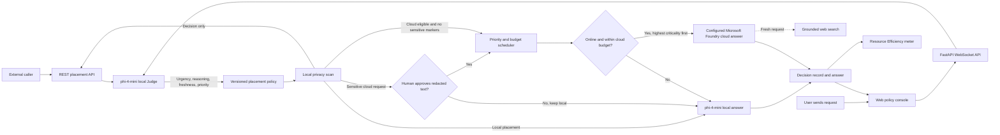

## Ecosystem boundary

Use AI in the Right Place is a placement service between AI callers and their
execution choices. The caller sends the work description and constraints,
receives an inspectable decision, and retains control over execution.

The application-to-API and Pi agent-runtime paths are implemented. Copilot
nodes describe the intended pluggable contract; this repository does not include
direct Microsoft 365 Copilot, Scout, or Cowork integrations.

## Pi integration

The Pi package under `integrations/pi/` implements the agent-runtime boundary
without changing Pi core:

The Local Executor owns the persistent Pi session and all tool access. The
Cloud Advisor is a stateless completion with one message containing only
`permitted_payload`; it receives no Pi system prompt, history, files, tools,
tool results, or images. This split is required because switching a normal Pi
session to a cloud model would send more context than RelayIQ approved.

## Implemented Foundry flow

The placement API ends at the decision-only return path and never invokes an
answer model. The policy console continues into the scheduler to demonstrate
local answers, cloud answers, consent, priority, budget, outage fallback, and
reconnection end to end.

## Placement and priority

The `phi-4-mini` local Judge emits urgency, reasoning depth, freshness,
category, tier, and priority. Low-reasoning requests without a freshness
requirement default to the local lane; other requests become cloud eligible.

Policy precedence can pause, sanitize, or adapt that placement. Privacy Guard v2
runs before cloud transmission; Resilient Fallback v1 activates when cloud is
unavailable. See [policies.md](policies.md).

The scheduler runs only after placement and privacy checks. It first checks
connectivity and remaining cloud data budget. When online, urgency is the
dominant queue signal, followed by reasoning depth and freshness, so critical
work is selected ahead of general work. When offline, the local model answers
immediately and eligible work remains available for later cloud refinement.

## Repository components

| Layer | Artifact | Responsibility |
|---|---|---|
| UI | `static/index.html` | Accepts user requests and renders answers, policy traces, approvals, metrics, and outage controls |
| API | `app/main.py` | Hosts the UI, accepts WebSocket commands, and starts isolated or mixed demo workloads |
| Placement | `app/placement.py` | Returns side-effect-free placement decisions, permitted payloads, fallbacks, model suggestions, and reason codes |
| Classification | `app/judge.py` | Uses the local Judge to classify urgency, reasoning depth, freshness, category, tier, and priority |
| Policy | `app/policy.py` | Converts Judge signals into versioned placement decisions and safe explanations |
| Privacy | `app/privacy.py` | Scans locally for sensitive markers, redacts identifier values, and requests consent before cloud egress |
| Scheduling | `app/scheduler.py` | Executes local work, queues cloud-eligible work, prioritizes critical requests, enforces budget, and adapts offline |
| Models | `app/foundry.py` | Discovers Foundry Local, loads local models, calls GPT cloud responses, and measures payload bytes |
| Configuration | `app/config.py`, `.env.example` | Models, endpoints, budgets, and estimate coefficients |
| Evaluation | `eval/` | Mixed challenge and synthetic conformance suites with accuracy, precision, recall, F1, and placement latency |
| Tests | `tests/` | API, placement, scheduler, privacy, policy, and metric regressions |
| Pi integration | `integrations/pi/` | Applies placement decisions while keeping Pi session state and tools local |
| GitHub | `README.md`, `CONTRIBUTING.md`, `SECURITY.md`, `.gitignore` | Public presentation and contribution hygiene |

## Trust boundaries

* The raw request enters local classification and privacy inspection.
* Calling the placement API cannot execute either answer adapter.
* A cloud request uses original text only when no sensitive marker is found.
* A sensitive cloud request uses only the locally sanitized preview after consent.
* Decision explanations contain policy signals, never detected identifier values.
* Payload bytes are measured; money and CO2 values are modeled estimates.

## API contract

`POST /v1/placement/decide` accepts an input string plus optional connectivity,
cloud budget, required capabilities, and available local and cloud model lists.
Omitted connectivity and budget use scheduler-observed values; an explicit
`null` budget is unbounded for that request. It returns a correlation UUID,
selected placement, policy, payload permitted to leave the local boundary,
consent requirement, local fallback, placement-specific model suggestions,
stable reason codes, and an explanation.

The current policy implementation actively uses classifier signals,
connectivity, privacy, and the scheduler's remaining budget context. Required
capabilities are accepted for compatibility, while capability-aware model
evaluation and ranking remain future work.

## Model roles

| Layer | Default | Role |
|---|---|---|
| Judge | `phi-4-mini` through Foundry Local | Classify urgency, reasoning depth, freshness, category, tier, and priority on device |
| Local answer | `phi-4-mini` through Foundry Local | Answer routine work and provide immediate best-effort fallback while offline |
| Real cloud answer | Configured deployment through the Microsoft Foundry Responses API | Handle fresh and extended-reasoning work after policy, privacy, connectivity, and budget checks |
| Cloud simulation | `phi-4-mini` by default through Foundry Local | Exercise queue, budget, byte accounting, and placement behavior without using cloud resources |
